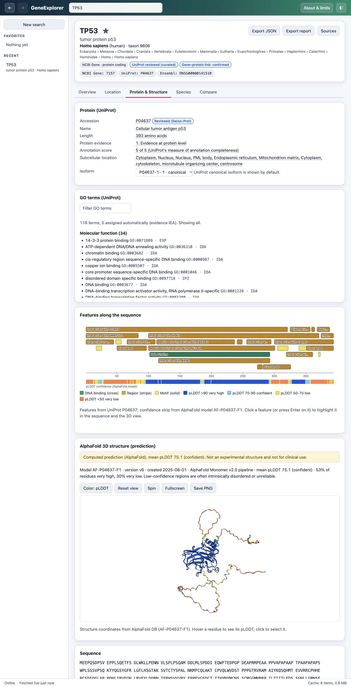
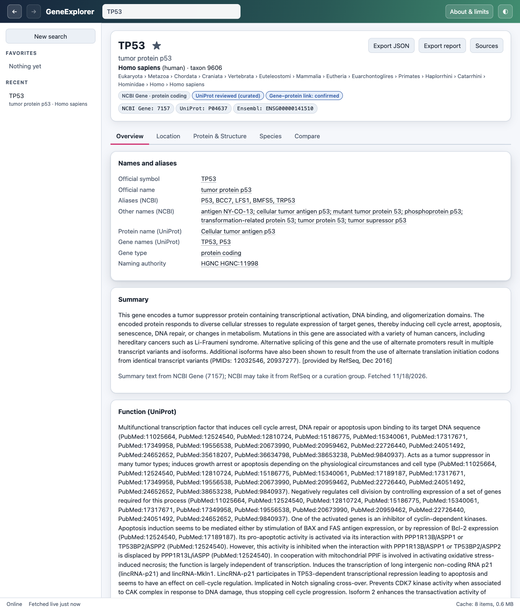
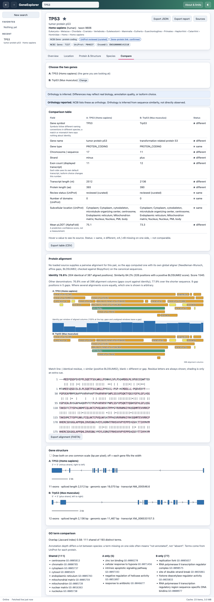
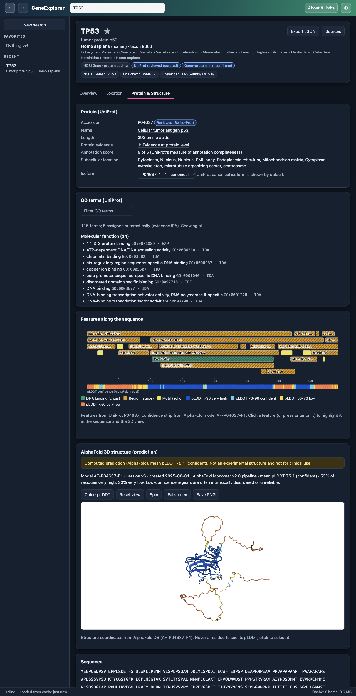

# GeneExplorer

GeneExplorer is a desktop app (Windows, macOS, Linux) for exploring a gene in any species: what it is, where it sits in the genome, its protein and AlphaFold 3D structure, its orthologs (the same gene in other species, from a common ancestor gene), and a side-by-side comparison of two genes with a structure overlay. Every fact shows where it came from, and anything missing says "not available" instead of being guessed.

**Educational use only.** Not a medical or clinical tool. AlphaFold structures are computer predictions, and orthology is inferred, not measured.



| Overview                                           | Compare                                           | Dark theme                                               |
| -------------------------------------------------- | ------------------------------------------------- | -------------------------------------------------------- |
|  |  |  |

## Download

Get an installer from the [Releases page](https://github.com/reeper316099/GeneExplorer/releases) (there is no release until the first `v0.1.0` tag is pushed) and check it against `SHA256SUMS` on the same page.

| OS      | File                                           |
| ------- | ---------------------------------------------- |
| Windows | `.exe` installer or portable `.exe` (x64)      |
| macOS   | `.dmg` (Apple Silicon `arm64`, or Intel `x64`) |
| Linux   | `.AppImage` or `.deb` (x64)                    |

### Unsigned apps (please read)

Windows and macOS builds are **UNSIGNED** (signing needs paid certificates). Your OS will warn you; that is expected for an unsigned app and not proof of a problem. Compare the file's SHA-256 with `SHA256SUMS` first.

- **Windows (SmartScreen):** "Windows protected your PC" → **More info** → **Run anyway**.
- **macOS (Gatekeeper):** drag the app to Applications. If it "can't be opened" or is "damaged", right-click the app → **Open** → **Open**. If that is not offered, run `xattr -dr com.apple.quarantine /Applications/GeneExplorer.app` once in Terminal (removes the download quarantine flag from this one app).
- **Linux:** `chmod +x GeneExplorer-*.AppImage` then run it, or `sudo apt install ./GeneExplorer-*.deb`.

There is no auto-update; download new versions manually. The app needs the internet; viewed genes are cached on disk for a limited time.

## Features

- Search by symbol plus species, NCBI Gene ID, UniProt accession (and isoform) or RefSeq accession.
- Gene overview, genome location and exon structure, UniProt protein features, AlphaFold 3D structure coloured by confidence (pLDDT).
- Orthologs from NCBI and OrthoDB, shown separately and never merged, with clade grouping, filters and CSV export.
- Compare two genes: field table, protein alignment, identity windows, FASTA/CSV export, and 3D overlay with RMSD.
- JSON export and a printable PDF report. Light and dark themes.

## How it works

```text
 UI (sandboxed page, vanilla TypeScript, no network access)
   |  typed IPC (preload bridge, validated messages)
   v
 Main process: net layer
   allowlist -> per-host rate limit -> in-flight de-dupe -> disk cache (TTL, SHA-256) -> retry/backoff
   |
   v
 Public APIs: UniProt | NCBI Datasets | AlphaFold DB | OrthoDB
   |
   v  each response parsed with zod -> Sourced<T> (value + database + record ID + fetch time)
 Core logic: identity via cross-references -> canonical isoform/transcript -> orthologs per source
 Workers: alignment, superposition      3D: 3Dmol.js
```

Identity mapping, ranking, alignment, superposition and the cache design are written up in [ALGORITHMS.md](ALGORITHMS.md). Sources, licences and citations are in [DATA-SOURCES.md](DATA-SOURCES.md) and on the app's About page.

## Honest-science notes

- Orthology is inferred by software. NCBI and OrthoDB use different methods, so they are shown side by side and "none in this source" does not mean "none exist".
- Genes and proteins are linked only by database cross-references, never by matching symbols. Unconfirmed links are labelled.
- UniProt entries are marked reviewed or unreviewed; the canonical isoform is shown with a manual switch; obsolete accessions show their replacements.
- AlphaFold models are predictions. Low-pLDDT regions are often flexible or disordered. A superposition RMSD measures backbone closeness for the matched residues, not shared function. Overlays are refused below 30% sequence identity.

## Validation

Run on 2026-11-18/19; details and tables in [docs/PHASE7-REPORT.md](docs/PHASE7-REPORT.md).

| Check                                                                                        | Data                                                | Result                               |
| -------------------------------------------------------------------------------------------- | --------------------------------------------------- | ------------------------------------ |
| Unit and property tests                                                                      | offline, fixtures                                   | 271 passed                           |
| Live contract checks                                                                         | real servers                                        | 58 passed                            |
| End-to-end in real Electron app                                                              | recorded fixtures                                   | 41 passed                            |
| Aligner vs Biopython 1.86                                                                    | 38 reference cases, plus 8 fresh real protein pairs | scores identical (max difference 0)  |
| Aligner vs brute force                                                                       | tiny inputs                                         | passed                               |
| Superposition vs Biopython                                                                   | 17 reference cases, plus 4 fresh structure pairs    | max RMSD difference 3.3e-16 angstrom |
| Spot-check vs NCBI E-utilities, UniProt FASTA, AlphaFold files, Alliance of Genome Resources | live, 9 genes in 8 species                          | 76 PASS, 0 FAIL, 14 informational    |
| Coverage (api, bio, core, net, cache)                                                        | unit tests                                          | 90.9% statements, 94.1% lines        |

Not validated: Windows and Linux installers and the CI workflows had not run when this was written (see [docs/PHASE8-REPORT.md](docs/PHASE8-REPORT.md)).

## Run it yourself

Needs Node 22 and npm.

```bash
npm ci
npm run dev                    # build and run with live rebuilds
npm run lint && npm run typecheck && npm run format:check
npm test                       # unit + property tests (offline)
npm run test:e2e               # Electron end-to-end tests on recorded fixtures (hidden window)
npm run test:contract          # real servers vs our parsers (needs internet)
npm run smoke:live             # one real request per source for 8 genes (needs internet)
npm run fixtures:record        # re-record fixtures from the real servers
npm run ref:generate           # regenerate Biopython references (needs tools/requirements.txt in a venv)
npm run pack                   # unpacked app in release/
npm run dist                   # installers for your own OS in release/
```

## Security

Context isolation on, Node integration off, sandbox on, strict Content-Security-Policy, no `eval`, and the page makes no network requests; the main process fetches from an allowlist. Navigation and new windows are blocked; external links open only for allowlisted `https` hosts. Test-only code is compiled out of release builds and `npm run verify:package` checks the packaged app for it.

## Limitations

- Windows/macOS builds unsigned; no auto-update.
- Ensembl is not used (unreachable from the development network). Ensembl IDs, HGNC IDs, OrthoDB group IDs and free-text name search are not searchable yet.
- NCBI lists at most one ortholog per species, so the "pick one of several" flow is covered by logic tests only.
- No per-domain superposition. PDF layout was checked by text extraction, not by viewing it.
- Large compares use about 850-890 MB of memory and cause a few short (under 215 ms) main-thread pauses while drawing.

## Publish it (exact steps)

1. On GitHub create an empty repository `reeper316099/GeneExplorer` (no README, no licence, no .gitignore).
2. In the project folder: `git add -A && git commit -m "GeneExplorer v0.1.0" && git branch -M main && git remote add origin https://github.com/reeper316099/GeneExplorer.git` (skip `remote add` if `origin` already exists), then `git push -u origin main`.
3. Open the **Actions** tab and wait for **CI** to go green. Fix anything red before releasing.
4. Create and push the tag: `git tag v0.1.0 && git push origin v0.1.0`. This starts the **Release** workflow.
5. When it finishes (it builds on three operating systems), open **Releases** → **v0.1.0**. The installers and `SHA256SUMS` are listed under Assets.
6. Download one for your OS and run the checklist at the end of [docs/PHASE8-REPORT.md](docs/PHASE8-REPORT.md).

## Stretch features, ranked by impact versus effort

1. **Scheduled live-contract check that opens an issue on API drift** (high impact, low effort). The contract tests already exist; add a weekly workflow.
2. **PAE viewer** (high impact, medium effort). AlphaFold's predicted aligned error shows which parts of a model are placed confidently relative to each other.
3. **Code signing, notarization and auto-update** (high impact, high effort, costs money). Removes the OS warnings.
4. **Gene neighbourhood / synteny view** (medium impact, medium effort). Shows neighbouring genes across species.
5. **Per-domain superposition and RMSD** (medium impact, medium effort). Fits each UniProt domain separately.

## What I learned

TODO (yours to write): a few honest sentences about what you learned building this.

## Licence

Code: MIT, see [LICENSE](LICENSE). The data belongs to its providers and stays under their licences ([DATA-SOURCES.md](DATA-SOURCES.md)).
